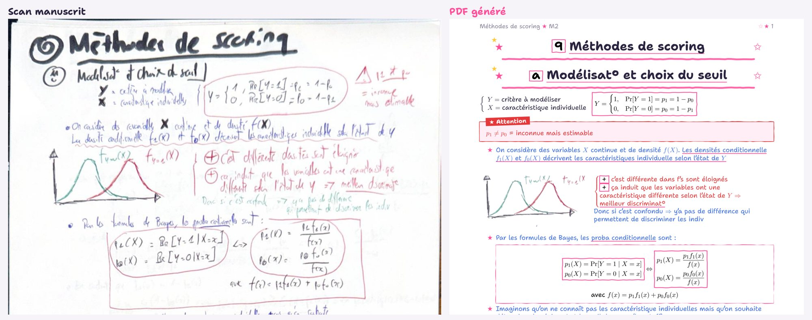
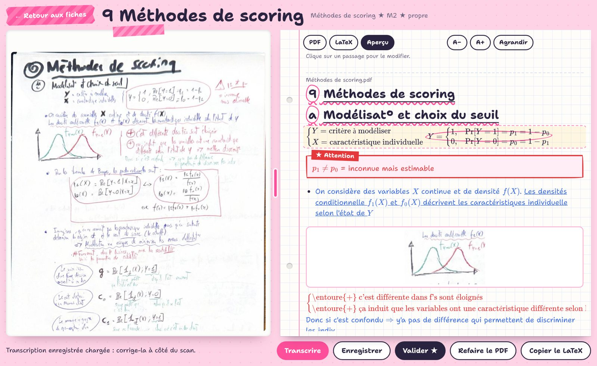
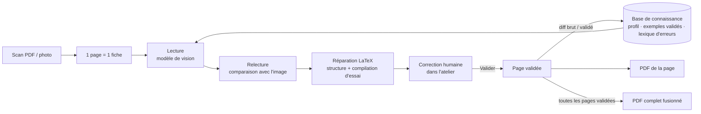

# ★ OCR Fiches — transcrire une écriture illisible en PDF LaTeX

Mes fiches de révision manuscrites (M2 Économétrie et Statistique Appliquée) → transcription LaTeX → PDF propre, avec un modèle de vision (Claude) qui **apprend mon écriture au fil de mes corrections**, sans entraînement de poids.



## Pourquoi ce projet

Par curiosité pour l'OCR, et pour une question simple : **est-ce qu'une machine peut lire une écriture aussi mauvaise que la mienne ?**

On me l'a souvent reproché. En licence, un camarade m'a demandé mes cours. Il a regardé mes fiches quelques secondes, puis :

> « Ahhh ouais en fait c'est bon t'inquiète, je vais demander ailleurs… merci quand même. »

Ce dépôt est la réponse. Les OCR classiques (Tesseract, et même les modèles de reconnaissance d'écriture génériques) s'effondrent sur ce genre de pages : maths denses, abréviations personnelles (`quantificat°`), flèches, accolades, couleurs, schémas dans les marges. Un modèle de vision généraliste fait beaucoup mieux, **à condition de lui apprendre l'auteur**. C'est tout l'objet du projet.

## Résultat

Sur la demi-page ci-dessus, le PDF est produit sans retouche manuelle de la mise en page :

- **titres numérotés et entourés**, soulignés comme sur la feuille ;
- **maths recomposées** : accolades, système `cases`, fractions, formules encadrées ;
- **le triangle « ⚠ » devient un encadré « Attention »** ;
- **couleurs d'encre conservées** (rouge, bleu, rose) et mots soulignés ;
- **le schéma n'est pas redessiné** : sa zone est repérée par le modèle, **découpée dans le scan** (fond blanchi, encres gardées) et replacée **avec le texte écrit à côté**, comme sur la feuille ;
- abréviations personnelles gardées telles quelles (`Modélisat°`, `discriminat°`).

Premières mesures (honnêtes, échantillon minuscule) : sur les pages validées avec le pipeline actuel, le **taux d'erreur par caractère (CER)** entre la sortie de l'OCR et la version que j'ai validée est de **0 % et 1,4 %**. Une page coûte en moyenne ≈ 13 000 jetons en entrée et ≈ 1 800 en sortie (lecture + relecture), soit environ 35 s.

Les exemples complets (scans, LaTeX, PDF par page et PDF fusionné) sont dans [`exemples/Fiches`](exemples/Fiches).

## L'interface

Un « tableau blanc » : une feuille par année, une par matière, puis l'atelier où l'on corrige la transcription à côté du scan, avec un aperçu rendu (MathJax) et le PDF final.

| Accueil | Atelier (aperçu) |
|---|---|
|  |  |

Deux panneaux de suivi : **Suivi des runs** (appels au modèle, jetons estimés, coût équivalent API) et **Qualité de l'OCR** (CER à chaque validation, par matière, erreurs les plus fréquentes).

## Comment ça marche



### « Entraîner » l'OCR sans entraîner de modèle

Aucun poids n'est modifié. Le modèle apprend **en contexte** : à chaque page, la consigne contient tout ce que mes corrections ont appris. Quatre mécanismes, tous automatiques :

1. **Profil d'écriture** (`mes_notations.txt`) : mes ambiguïtés connues, écrites une fois. Mon `2` en exposant ressemble à un `λ`, mon `Σ` à un `ξ`, `°` en fin de mot veut dire « -ion »…
2. **Exemples validés (few-shot visuel)** : 2 pages que j'ai déjà corrigées sont jointes à la demande, image **et** LaTeX validé, pour que le modèle imite mes conventions (macros, mise en forme).
3. **Lexique d'erreurs appris** : à chaque validation, la sortie brute de l'OCR est comparée à ma version (diff par jetons LaTeX, `difflib`). Chaque petit remplacement est retenu **avec un jeton de contexte** de chaque côté (`^ 2 }` → `^ \lambda }` n'est pas la même règle que `σ ^ 2`). Les plus fréquents sont rappelés au modèle comme « erreurs que tu as déjà faites, vérifie ces cas ».
4. **Sélection des exemples guidée par la mesure** : chaque validation enregistre le CER et les exemples utilisés. Un exemple jamais essayé passe en priorité (exploration), puis les exemples associés aux meilleurs CER. Un exemple qui, après 3 utilisations, fait nettement monter le CER (> 1,5 × la moyenne + 2 points) **est écarté automatiquement**. La base grossit sans dégrader la qualité.

Les mots marqués `\illisible{…}` sont nettoyés à la validation (si je valide, c'est que le mot est juste), et les lignes que la compilation avait dû mettre de côté ne servent jamais d'exemple.

Le détail (prompts, métrique, réparation LaTeX, découpe des dessins) est dans [docs/fonctionnement.md](docs/fonctionnement.md).

### Et un vrai fine-tuning ?

Chaque page validée laisse un triplet **(image du scan, sortie brute, LaTeX validé)** dans `_ocr/<document>/` (`pNN.brut.txt`, `pNN.tex`). C'est exactement le jeu de données qu'il faut pour un fine-tuning supervisé (LoRA) d'un modèle de vision open source. L'apprentissage en contexte suffit pour l'instant, mais le dataset se constitue tout seul.

## Installation

Prérequis : Python 3.11+, une distribution LaTeX avec **XeLaTeX** (TinyTeX ou MiKTeX ; paquets : `tcolorbox`, `fontspec`, `pifont`, `pdfcol`, `listings`, `hyphenat`, `ulem`).

```bash
git clone https://github.com/jarod-8723/ocr-fiches && cd ocr-fiches
pip install -r requirements.txt
```

### Option 1 : application Streamlit avec une clé API Anthropic

```bash
export ANTHROPIC_API_KEY=sk-ant-...        # ou dans la barre latérale, ou .streamlit/secrets.toml
streamlit run app/streamlit_app.py
```

L'application affiche **exactement la même interface** que la version claude.ai. Le tableau (`tableau/index.html`) n'est pas réécrit : `app/serveur_web.py` le sert en local et lui injecte une petite cale qui recrée l'environnement `window.claude` qu'il attend :

- `claude.use('mcp')` → `POST /api/outil` → les fonctions de `serveur/fiches_core.py` (lecture des dossiers, scans, LaTeX, compilation) ;
- `claude.use('sample')` → `POST /api/claude` → API Anthropic (Messages, images en base64).

Par défaut, la lecture « précise » utilise `claude-opus-5-5` et la lecture standard `claude-sonnet-5-5` (variables `OCR_MODELE_PRECIS`, `OCR_MODELE`). `OCR_SIMULATION=1` permet de tester l'interface sans appel ni dépense. Sans Streamlit : `python app/serveur_web.py --fiches exemples/Fiches`.

Le dossier par défaut est `exemples/Fiches` : on peut tout parcourir et retranscrire les pages d'exemple tout de suite.

### Option 2 : dans Claude Desktop (sans clé API)

C'est la version que j'utilise : le tableau est un artifact claude.ai, et `serveur/serveur_fiches.py` est un **serveur MCP local** lancé par Claude Desktop. L'OCR passe alors par l'abonnement Claude, sans clé API. Configuration : [`serveur/claude_desktop_config.exemple.json`](serveur/claude_desktop_config.exemple.json).

`serveur_fiches.py` ne fait que déclarer les 4 outils MCP. Il recharge `fiches_core.py` à chaud dès que ce fichier change : on met à jour la logique sans relancer Claude Desktop.

## Organisation d'un dossier de fiches

```
Fiches/
  mes_notations.txt                 profil d'écriture
  _base/                            base de connaissance : lexique.json, journal_ocr.csv, runs.jsonl
  M2 - Master ESA/
    Méthodes de scoring/
      Méthodes de scoring.pdf       le scan (jamais modifié)
      PDF/Méthodes de scoring.pdf   PDF complet, fusionné quand toutes les pages sont validées
      _ocr/Méthodes de scoring/
        p01.tex  p01.pdf  p01.brut.txt
```

## Structure du dépôt

```
serveur/   serveur MCP (serveur_fiches.py), logique (fiches_core.py), style LaTeX (latex/fiche.sty + polices)
tableau/   l'interface (un seul fichier HTML)
app/       serveur web local + application Streamlit
exemples/  vraies fiches : scans, transcriptions, PDF
docs/      fonctionnement détaillé, images
```

## Limites

- Le CER n'est mesuré que sur les pages que je valide. Une page validée sans rien changer compte 0 %, ce qui flatte la moyenne.
- Les schémas sont des découpes du scan, pas des figures vectorielles. Leur zone, donnée par le modèle, peut être légèrement décalée.
- Les macros de mise en page de `fiche.sty` sont spécifiques à mes fiches (couleurs, encadrés, « Attention »…).

## Crédits

Projet personnel de Jarod Guénin (M2 ESA, Université d'Orléans), développé avec l'aide de Claude (Anthropic).
Police manuscrite : [Shantell Sans](https://github.com/arrowtype/shantell-sans) (SIL Open Font License 1.1).
Code sous licence MIT.
